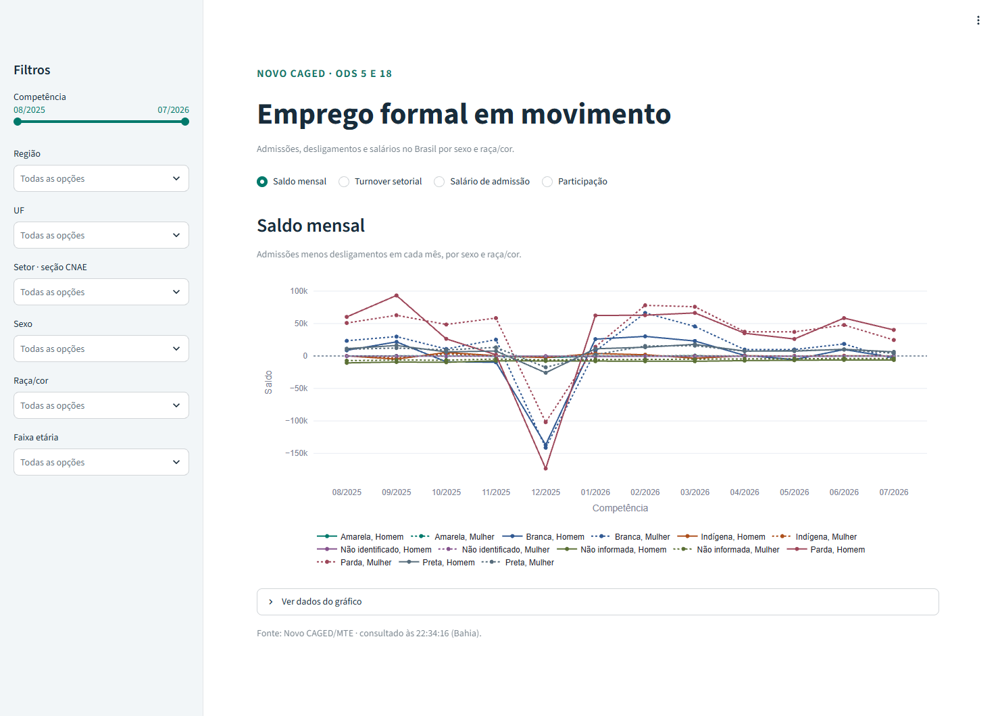
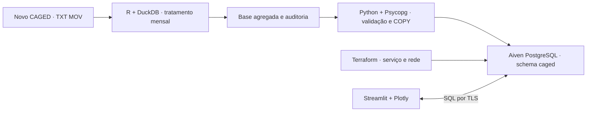
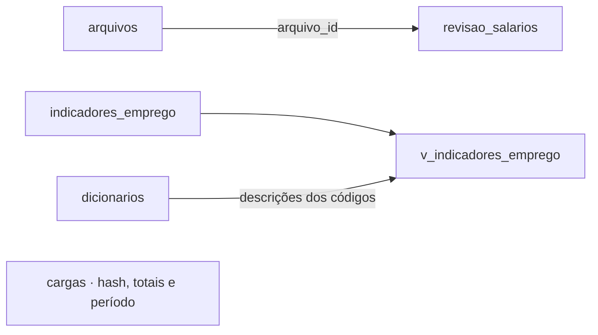

# Dinâmica de Emprego Formal e Turnover Setorial

Projeto de Big Data e Analytics da UCSal. **Equipe:** João Victor Rocha Massena, Luísa Garrido Matos e Marco Antônio Duarte Oliveira.

O painel investiga quem entra e sai do emprego formal e como o salário de admissão varia no cruzamento entre sexo e raça/cor. A análise atende à ODS 5, de igualdade de gênero, e à ODS 18 brasileira, de igualdade étnico-racial.

## Abrir o painel

**Painel publicado:** https://caged-emprego-ods.streamlit.app

Para executar localmente, com Python 3.12, as dependências de `requirements.txt` e a conta de leitura configurada, execute na raiz:

```sh
python -m streamlit run dashboard/app.py --server.address localhost
```

O painel consulta diretamente o PostgreSQL já provisionado no Aiven. Alterar os filtros gera consultas parametrizadas ao banco. As capturas abaixo servem de apoio se a conexão ficar indisponível durante a apresentação.

A publicação usa o Streamlit Community Cloud a partir deste repositório, com `dashboard/app.py` como arquivo principal e Python 3.12. Host, porta, banco, usuário `caged_dashboard`, senha e o certificado CA (`PGSSLROOTCERT_PEM`) ficam nos segredos da plataforma, fora do Git. Os IPs de saída do Streamlit Community Cloud, publicados na documentação da plataforma, foram incluídos na lista de acesso do serviço no Aiven, que continua exigindo TLS e senha.



[Turnover setorial](documentacao/capturas/turnover.png) · [Salário de admissão](documentacao/capturas/salario.png) · [Participação por setor](documentacao/capturas/participacao.png)

## Indicadores

| Indicador | Definição e interação |
| --- | --- |
| **Saldo mensal** | Admissões menos desligamentos por competência, sexo e raça/cor. O gráfico mostra a evolução mensal e a tabela permite conferir as contagens de cada grupo. |
| **Turnover setorial** | Desligamentos divididos por admissões, por seção CNAE, mês, sexo e raça/cor. O gráfico inclui seleção de setor e competência. Sem admissões, a razão fica indefinida. |
| **Salário de admissão** | Soma dos salários válidos dividida pela quantidade de salários válidos, somente em admissões, por sexo e raça/cor. A tabela mostra o percentual da maior média do recorte e a quantidade de salários usada. |
| **Participação por setor** | Percentual de mulheres e de pessoas negras em cada fluxo. Pessoas negras correspondem às categorias preta e parda. A série de mulheres responde ao filtro de raça/cor. A série de pessoas negras responde ao filtro de sexo. |

Filtros de competência, região, UF, seção CNAE, sexo, raça/cor e faixa etária. **Não informada** e **Não identificado** aparecem como categorias separadas.

## Resultados e limites

A base representa **51.893.337 movimentações** entre agosto de 2025 e julho de 2026 em **1.006.405 linhas agregadas**. Foram **26.382.492 admissões**, **25.510.845 desligamentos** e saldo MOV de **871.647**. A conferência de 21/11/2026 registrou **195.507.903 bytes** no Aiven e confirmou TLS, totais mensais e somas salariais. As consultas abaixo foram executadas com a conta de leitura do painel. [Evidência da carga atual](verificacoes/carga_nuvem.json) · [Consultas de reprodução](sql/analise_ods.sql)

- **ODS 5.** Mulheres responderam por **43,21%** das admissões e **42,48%** dos desligamentos. Entre as admissões, a participação feminina foi de **8,58%** na Construção e **78,24%** em Saúde Humana e Serviços Sociais. A diferença mostra como a composição das contratações varia com o setor.
- **ODS 18.** Pessoas pretas e pardas somaram **59,99%** das admissões e **58,22%** dos desligamentos. Mulheres pretas e pardas corresponderam a **24,25%** das admissões e **23,02%** dos desligamentos. A composição dos fluxos por grupo complementa a leitura do saldo.
- **Gênero e raça/cor juntos.** Com a média dos homens brancos (**R$ 2.909,42**) como referência, o salário médio de admissão de mulheres pretas (**R$ 2.202,79**) foi **24,29% menor** e o de mulheres pardas (**R$ 2.160,15**) foi **25,75% menor**. A diferença é a distância da média do grupo como percentual da média dos homens brancos. Entre homens com raça/cor não informada, a média foi de **R$ 8.589,40**, com apenas **97 admissões**.

O recorte cobre movimentações do emprego formal. Análises de participação descrevem eventos, que podem se repetir para a mesma pessoa. O saldo MOV exclui FOR, EXC e revisões posteriores. Sem estoque dos vínculos, o painel usa uma razão de fluxos para o turnover. A base registra **157.561** movimentos com raça/cor não informada e **4.948** não identificados. A comparação salarial é descritiva, em valores nominais, sem controles de ocupação, escolaridade ou jornada. A média é sensível a valores extremos, sobretudo em grupos com poucas admissões.

## Arquitetura e modelagem





A linha da tabela de fatos combina competência, região, UF, seção CNAE, sexo, raça/cor, faixa etária, tipo de movimentação e fluxo. Contagens usam `BIGINT` e a soma salarial usa `NUMERIC(38,6)`. PostgreSQL permite transações de carga, integridade e agregações SQL sobre o modelo relacional. [Diagrama ER, chaves e dicionário](documentacao/MODELAGEM.md) · [Códigos das categorias](referencias/dicionarios.csv)

O Aiven Free existente foi reconciliado com o state privado do Terraform. O ajuste incluiu um IPv6 `/128` para acesso ao PG Studio. O plano posterior confirmou convergência. [Evidência da infraestrutura](verificacoes/terraform_entrega.json)

## Dados, qualidade e 5 Vs

| V | Aplicação |
| --- | --- |
| Volume | Agregação mensal antes do envio ao plano gratuito, com contagens e somas preservadas. |
| Variedade | TXT delimitado e tabelas são estruturados. Manifestos JSON são semiestruturados. A base analítica dispensa fontes textuais não estruturadas. |
| Velocidade | Tratamento em lote por competência e consultas interativas ao PostgreSQL com cache curto. |
| Veracidade | Conferência de cabeçalhos, competências, SHA-256, contagens e somas. Idades inválidas permanecem em uma categoria própria e salários recusados saem da média. |
| Valor | Recortes interseccionais tornam visíveis diferenças de participação e remuneração de entrada entre grupos e setores. |

A base usa microdados públicos do MTE. A entrega publica agregados e metadados, com um recorte sem identificadores individuais e aderente à finalidade acadêmica. O pipeline preserva eventos semelhantes, pois os dados carecem de identificador para deduplicação segura. [Fonte oficial Novo CAGED/PDET](https://www.gov.br/trabalho-e-emprego/pt-br/acesso-a-informacao/acoes-e-programas/programas-projetos-acoes-obras-e-atividades/estatisticas-trabalho/microdados-rais-e-caged) · [Proveniência e hashes](dados/arquivos_origem.csv)

## Tratamento e justificativas

O R coordena o processo e o DuckDB lê um mês por vez, limitando memória e evitando carregar todos os TXT simultaneamente. Os SQLs em `sql/` concentram as regras de transformação.

| Característica ou problema | Decisão e justificativa |
| --- | --- |
| Espaços, vazios e cabeçalhos acentuados | Remover espaços laterais, converter vazios em nulos e padronizar nomes após conferir o cabeçalho esperado |
| Códigos categóricos numéricos | Preservar como texto e traduzir por dicionário, evitando perder a representação ou inventar rótulos |
| Competência divergente do arquivo | Interromper; quando ausente, preencher pelo mês identificado no nome do arquivo |
| Idades ausentes ou fora de 14 a 100 | Manter o evento na faixa `Nao informado ou invalido`; esse intervalo é uma decisão analítica da equipe |
| Salários com vírgula e separadores de milhar | Converter formatos decimais aceitos com até seis casas; utilizar soma decimal para preservar precisão |
| Salários negativos, inválidos ou em notação científica | Preservar o evento nas contagens; retirar o salário da média. Formatos recusados ficam na auditoria para revisão na fonte |
| Salário igual a zero | Incluir na média, mantendo a regra já adotada na etapa anterior |
| Registros aparentemente repetidos | Não remover: podem representar eventos distintos e não há identificador individual para deduplicação segura |
| Volume elevado | Agregar pelas dimensões de análise, conservando contagens e soma salarial para recompor indicadores |

A notação científica é matematicamente válida. Sua exclusão da média é uma regra explícita desta versão, motivada pela revisão dos valores extremos encontrados; não significa que todo valor nesse formato seja incorreto. A auditoria publicada contém **21 ocorrências**, registradas em `dados/auditoria_salarios.csv` e vinculadas ao pacote por hashes.

São conferidos hashes, 12 competências, unicidade de IDs e grupos, equivalência entre eventos de origem e contagens agregadas, `saldo = admissoes - desligamentos` e os limites das contagens salariais.

## Evolução do projeto

| Etapa | Planejamento ou entrega | Evolução e motivo |
| --- | --- | --- |
| Fase 1 | R para leitura, Python/Pandas para chunking e PostgreSQL/Aiven para agregados. | O DuckDB assumiu o processamento em SQL por competência, coordenado pelo R. |
| Fase 2 | Tratamento de 17 campos, agregação mensal e carga RPostgres em blocos. | A camada analítica preservou dimensões, contagens e pesos salariais. Campos detalhados ficaram na preparação e os originais foram rastreados por hash. |
| Fase 3 | Validação e carga em Python com infraestrutura versionada. | Psycopg passou a enviar o CSV por `COPY` transacional. O serviço Free existente no Aiven foi importado para o Terraform. |
| Entrega final | Painel interseccional e demonstração. | Aiven permaneceu como provedor. Streamlit e Plotly consultam a view PostgreSQL por TLS, com filtros, detalhamento e quatro indicadores. |

## Execução

Ferramentas: Python 3.12 com `requirements.txt`, R com DBI, DuckDB, digest e jsonlite (somente para refazer o tratamento) e Terraform com o provider Aiven. Na raiz do projeto, no PowerShell:

```powershell
py -3.12 -m venv .venv
.\.venv\Scripts\python.exe -m pip install -r requirements.txt
Rscript codigo/executar.R tratamento
.\.venv\Scripts\python.exe codigo/executar.py validar
.\infraestrutura\configurar_token.ps1
terraform -chdir=infraestrutura apply
.\codigo\configurar_conexao.ps1
.\.venv\Scripts\python.exe codigo/executar.py carga
.\.venv\Scripts\python.exe -m streamlit run dashboard/app.py --server.address localhost
```

1. **Tratamento.** `executar.R tratamento` lê os 12 TXT colocados em `dados_originais/` e gera a base agregada. Pode ser pulado: a base tratada já está em `resultados/base_tratada.zip`.
2. **Validação.** `executar.py validar` confere hash, totais mensais e consistência da base.
3. **Infraestrutura.** O token Aiven é pedido com entrada oculta e o Terraform provisiona o PostgreSQL Free com filtro de IPs, usando um `terraform.tfvars` privado criado a partir de `terraform.tfvars.example`.
4. **Carga.** Com host, porta, banco, usuário, senha e CA informados no prompt, `executar.py carga` cria o schema `caged` e envia a base por `COPY` em uma transação. `executar.py verificar-nuvem` repete a conferência no banco e grava `verificacoes/carga_nuvem.json`.
5. **Painel.** O Streamlit consulta o PostgreSQL diretamente com a conta de leitura `caged_dashboard`, criada conforme `sql/permissoes_dashboard.sql`.

## Segurança

O painel usa TLS `verify-full` e uma conta de leitura da view. `.env`, token, CA local, variáveis privadas, state e planos Terraform ficam fora do Git. Rode `python codigo/verificar_segredos.py` para verificar o índice antes do envio. [Gestão de acessos](documentacao/SEGURANCA.md)
